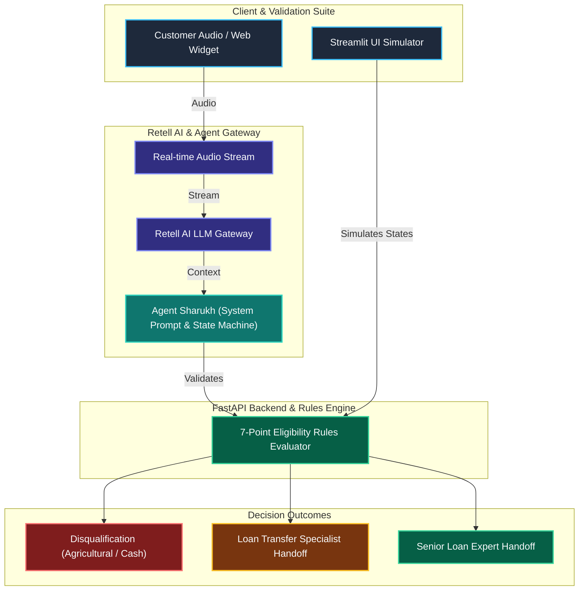

# Home Credit Loan Against Property (LAP) AI Voice Agent

An enterprise-grade, single-prompt Conversational AI Voice Agent built for Home Credit to automate the preliminary qualification of pre-approved Loan Against Property (LAP) offers up to ₹75,00,000. The agent operates with natural human-like conversational flows, handles out-of-order user responses via a dynamic state machine, enforces strict business disqualifications, and seamlessly executes senior loan expert handoffs.

## 🏗️ Architecture & 3D Flow Diagram

The architecture bridges a real-time Voice AI orchestration platform with a robust Python/FastAPI backend and an interactive Streamlit testing simulator. Below is the workflow and logical architecture rendered with a visual Mermaid diagram:



## 🚀 Key Components

1. **AI Voice Agent ("Sharukh"):**
  * Configured as a male professional advisory voice agent representing Home Credit.
  * Built using optimized single-prompt structures to maintain natural dialogue cadence, handle conversational fillers, interruptions, and phonetic variations.
2. **The 7-Point Eligibility Checklist Engine:**
  * **Property Type:** Validates Residential, Commercial, or Industrial properties (Strictly disqualifies Agricultural land).
  * **Ownership Status:** Captures Sole or Joint ownership.
  * **Document Status:** Requires original document availability (Disqualifies photocopies/Xerox).
  * **Desired Loan Amount:** Validates against the pre-approved limit ($\le \text{₹}75,00,000$).
  * **Occupation & Income Mode:** Evaluates Salaried or Self-Employed status with mandatory Bank credit routing (Strictly disqualifies Cash-based income). 
  * **Market Value:** Records estimated property valuation.
  * **Tenure:** Validates repayment duration between 3 and 15 years.
3. **Dynamic State Management & Out-of-Order Handling:**
  * Implements a First Missing Question Algorithm. If customers provide details out of sequence (e.g., stating tenure and loan amount during greeting), the agent records them instantly and bypasses those queries in subsequent turns.
4. **Interactive Streamlit UI Simulator:**
  * Allows QA and developers to test conversational states, parameter extraction, and edge cases locally before voice deployment.

## 🧰 Tech Stack

  * **Voice AI & Telephony Platform:** Retell AI (Single-Prompt Agent Architecture)

  * **Backend Framework:** FastAPI (Python 3.11+)

  * **Frontend & UI Simulator:** Streamlit

  * **Validation Engine:** Pydantic / Custom Python State Handlers

  * **Version Control & Deployment:** Git, Uvicorn

## 🛠️ Challenges Faced & How We Solved Them

1. **Handling Out-of-Order Customer Responses**

   * **Challenge:** Traditional IVR bots break or repeat questions if a customer answers multiple criteria at once (e.g., "I want 50 lakhs for 10 years on my residential flat").

   * **Solution:** Designed a dynamic state-tracking prompt architecture that parses full sentences, extracts all mentioned checklist parameters simultaneously, and intelligently skips ahead to the earliest unanswered question.

2. **Managing Immediate Disqualification Scenarios Gracefully**

   * **Challenge:** Abruptly dropping calls on sensitive negative inputs (like agricultural land or cash income) creates a poor customer experience.

   * **Solution:** Engineered empathetic yet firm termination rules into the system prompt. The agent politely acknowledges the criteria, states the specific policy reason without sounding robotic, and closes the interaction professionally.

3. **Routing Transfer Intent vs. Fresh Loan Processing**

   * **Challenge:** Customers inquiring about existing loan balance transfers or EMI reductions were getting funneled into the fresh loan qualification flow.

   * **Solution:** Introduced an early Stage 2 Intent Filter that detects existing property loan intent immediately and redirects the lead to a specialized loan-transfer workflow.
  
## ⚙️ Installation & Local Testing Guide
1. **Clone the repository:**
```
git clone https://github.com/subair247/home-credit-lap-voice-agent.git
cd home-credit-lap-voice-agent
```

2. **Install dependencies:**
```
pip install -r requirements.txt
```

3. **Run the FastAPI Backend:**
```
uvicorn src.main:app --reload --port 8000
```

4. **Run the Streamlit UI Simulator (in a new terminal):**
```
streamlit run app.py
```